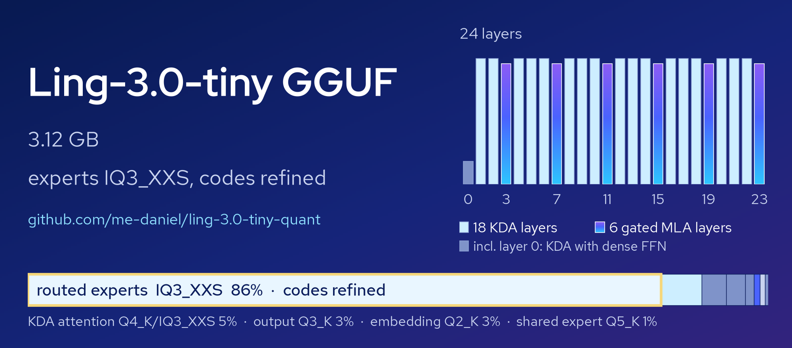
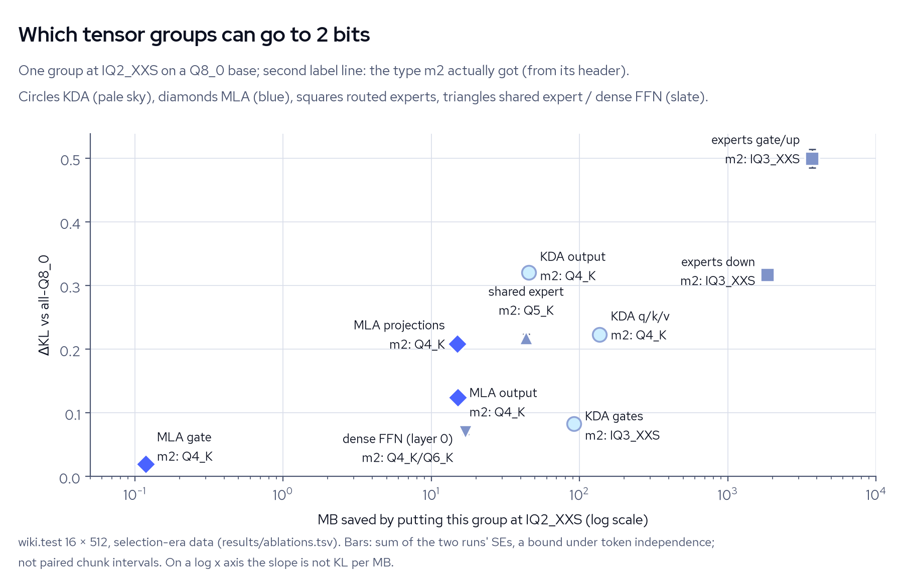

# ling-3.0-tiny-quant

We ran a short quantization pilot for the Ling-3.2 models.

<!-- DRAFT, true as of 25 Nov 2026. Fill every "TBD (release gate)" from results/release-gate.md / .tsv.
     Banner: re-render with --layout of the scored file and --record (scripts/refine_record.py) before it may say
     refined. Alt text: figures/alt.md. Never link figures/demo/ (synthetic, git-ignored). -->

<picture>
  <source media="(prefers-color-scheme: dark)" srcset="figures/banner-dark.png">
  
</picture>

We ran this pilot on [inclusionAI/Ling-3.0-tiny](https://huggingface.co/inclusionAI/Ling-3.0-tiny) (revision `9a98e35fe1c9ee255f78dd64771c7ae15a799481`) as a low-cost way to check what llama.cpp supports on the `bailingmoe3` architecture before we quantize Ling-3.2-air. Every run used one Apple M5 Pro with 48 GB, llama.cpp `c661033` and Metal.

Our sensitivity-allocated mix, m2, is 3.12 GB. On the first 16 chunks of each selection set, its mean KL to BF16 was 20% lower than that of bloomer010 IQ3_XXS on wiki.test and 26% lower on eval-ood (`results/ablations.tsv`). The expert-code refinement on m2 and the four-set release comparison are pending.

- Model on Hugging Face: TBD (release gate)
- Findings for Ling-3.2-air: [results/findings.md](results/findings.md)
- Dated log, registrations and the status of every number: [CHANGELOG.md](CHANGELOG.md)

## Release gate

TBD (release gate): figure A with its alt text, and the table from `results/release-gate.md`.

We registered the gate on 25 Nov 2026, before any release scores existed. We compare the candidate with bloomer010 IQ3_XXS (3.13 GB, `results/twin.md`) and bartowski Q2_K_L, the nearest bartowski file at least as large as m2 (3.24 GB, `ea07272`, CHANGELOG 25 Nov). The sets are zh, code and tool at 128 × 512 and four PG19 books at 8 × 4,096, with one BF16 reference per set and a Q8_0 run as a reference point. Against each comparator separately, the candidate passes only if its KL is lower on all four sets with the paired 95% interval below zero, and its file is not larger; the intervals are pointwise. `scripts/release_gate_report.py` checks every file, count and byte size, applies the gate once using unrounded values and prints a book-stratified PG19 interval as a sensitivity check.

## Allocation and refinement

### Which tensor groups can go to 2 bits

<picture>
  <source media="(prefers-color-scheme: dark)" srcset="figures/sensitivity-dark.png">
  
</picture>

During selection, we measured KL on wiki.test at 16 × 512 with one group at IQ2_XXS on a Q8_0 base (`results/ablations.tsv`, ratios in `results/q7-sensitivity.md`). Per GB saved, the routed experts add 0.13 (gate/up) and 0.17 (down) KL; KDA output adds 7.0, and the three MLA groups 8.1 to 161. That is why m2 keeps the experts at IQ3_XXS and spends the bytes elsewhere. The bars are the sum of the two runs' SEs, a bound under token independence, not paired chunk intervals.

### m2 against stock and public quantizations

| 16 × 512, `results/ablations.tsv` | wiki.test KL | eval-ood KL | m2 relative |
|---|---|---|---|
| m2 (3.12 GB) | 0.367 | 0.328 | |
| stock IQ3_XXS, same mixc imatrix (3.13 GB) | 0.436 | 0.419 | −16% / −22% |
| bloomer010 IQ3_XXS (3.13 GB) | 0.457 | 0.442 | −20% / −26% |

We chose m2 from four candidates measured on the first 16 wiki chunks; eval-ood was held out from that choice.

### Refinement

The refiner keeps every block scale and re-chooses each low-bit grid code to minimise an estimate of expert-output error on calibration inputs (input Gram matrices from 400 × 512 tokens of mixed text), so types and byte counts stay the same.

- Gate T, experts only on a Q8_0 base (`results/gate-t.md`, 64 × 512): IQ3_XXS ratio 0.818 (wiki) and 0.804 (ood), IQ2_XXS 0.785 and 0.781, every paired interval below zero. PASS.
- m2 with refined experts (m2r) and with refined KDA gates (m2rd): TBD (release gate run list). Figure B (`figures/ladder-*.png`) renders once these 64-chunk runs exist.

### Refined codes on a public file (twin test)

We refined the expert codes in bloomer010's IQ3_XXS and kept its scales and every other tensor byte for byte (`results/twin.md`, paired bootstrap over chunks).

| Set | Chunks | bloomer010 | Twin | Twin − bloomer010 [95% CI] | Ratio [95% CI] |
|---|---|---|---|---|---|
| wiki.test (512) | 64 | 0.5030 | 0.4520 | −0.0510 [−0.0619, −0.0401] | 0.899 [0.879, 0.918] |
| eval-ood (512) | 64 | 0.3372 | 0.3095 | −0.0277 [−0.0371, −0.0186] | 0.918 [0.891, 0.945] |
| wiki.test (4,096), not in the rule | 16 | 0.4037 | 0.3731 | −0.0306 [−0.0402, −0.0210] | 0.924 [0.904, 0.946] |

The registered rule required a ratio of 0.90 or lower on both 512 sets. The twin failed because its ratio on eval-ood was 0.918. In absolute terms the reductions are similar to gate T's on a Q8_0 base (−0.0540 and −0.0344).

## Findings

| # | Question | Verdict |
|---|---|---|
| Q0 | Does llama.cpp's `bailingmoe3` forward match the HF reference? | Works. KL 9e-4 to 1.8e-3 on a 2,000-token prompt, top-1 ≥ 98.7% |
| Q1 | BF16 safetensors → GGUF | Works. 57 s, 526 tensors |
| Q2 | Q8_0 | Works, with a high floor. KL 0.0075 ± 0.0004 |
| Q3 | Do requested types land where asked? | Works, except MLA `attn_k_b` (row width 128), which falls back |
| Q4 | Does an imatrix cover KDA, MLA and every expert? | With mixed calibration text, every expert gets tokens. Wiki text alone leaves 63 to 97 of 2,944 unseen |
| Q5 | Does KL grow with context? | Flat for KDA groups, rising for MLA (direction only) |
| Q7 | Does a sensitivity-guided mix beat stock IQ3_XXS? | m2 vs stock IQ3_XXS (same imatrix): −16% (wiki), −22% (ood), at a smaller file |
| Q8 | Does the converter take Ling-3.2-air? | Works in dry-run |
| T | Does the full-Gram code refiner cut KL on `bailingmoe3` experts? | Yes, on a Q8_0 base; see gate T above |

Details, evidence and the cost model: [results/findings.md](results/findings.md).

## What this repository holds

| Path | What it holds |
|---|---|
| `scripts/` | Conversion, ablation, Gram capture, refiner, splice and checks, reports, figures (`figures.py`, `style.py`) |
| `results/` | Generated reports and TSVs (`ablations.tsv`, `gate-t.md`, `twin.md`, `layout-m2.tsv`, ...) and `findings.md` |
| `patches/` | Patches on llama.cpp `c661033` (below) |
| `figures/` | Card figures as PNG and SVG, plus `alt.md` |
| `tests/` | Tests for the refiner |
| `CHANGELOG.md` | Dated log and registrations |

Not in git: model files (`models/`), calibration and eval text (`data/`), logs and per-token dumps (`logs/`, `runs/`), the llama.cpp clone (`vendor/`). The scripts rebuild them; the data recipes, book ids and hashes are TBD (release gate).

## Patches

These patches apply to llama.cpp `c661033`. Running a GGUF requires none of them.

| Patch | What it does |
|---|---|
| `patches/0010-imatrix-gram-capture.diff` | `llama-imatrix` also writes a full input Gram per routed expert, for the refiner |
| `patches/0011-perplexity-kld-dump.diff` | `llama-perplexity --kl-divergence` dumps per-token KL (`KLD_DUMP`), so intervals come from exact chunk means |
| `patches/0012-imatrix-gram-capture-dense.diff` | 0010 plus Grams for dense matrices; apply instead of 0010 |

## Reproduce

```sh
sh scripts/convert-q8.sh                                          # BF16 GGUF and Q8_0
IMATRIX=<imatrix.gguf> EVAL=<text> sh scripts/ablate.sh <name> <base_type> 'regex=type' ...   # one ablation row
sh scripts/gate_t.sh build U3 && sh scripts/gate_t.sh base        # gate T builds and BF16 bases
sh scripts/twin_chain.sh                                          # twin, m2r and cheap modes
.venv/bin/python -I scripts/gate_t_report.py > results/gate-t.md
# release gate scoring commands: TBD (release gate); dumps go to runs/release/NAME-SET.f32, logs to logs/rg-kld-*.log
.venv/bin/python -I scripts/release_gate_report.py --gguf cand=<release.gguf> bartowski=<Q2_K_L.gguf> > results/release-gate.md
.venv/bin/python -I scripts/gguf_layout.py <release.gguf> results/layout-release.tsv
.venv/bin/python -I scripts/refine_record.py models/ling-3.0-tiny-m2.gguf <release.gguf> results/refinement-release.json
for t in light dark; do .venv/bin/python -I scripts/figures.py --theme $t \
  --layout results/layout-release.tsv --record results/refinement-release.json; done
```

The figures use Red Hat Display and Red Hat Text from Google Fonts, kept in `build/fonts/` (git-ignored). Without them `scripts/style.py` falls back to DejaVu Sans and says so.

Checks: `.venv/bin/python -I -m pytest -q tests` and `.venv/bin/python scripts/test_fla_torch.py`.

## Status

This is a proof of concept, not a result about Ling-3.2-air. KL against BF16 measures closeness to the original model, not task quality; a HellaSwag check and a loop check are proposed, not run. Everything ran on one machine, at one engine commit, with one calibration text. Code license: TBD. Changes and registrations: [CHANGELOG.md](CHANGELOG.md).
